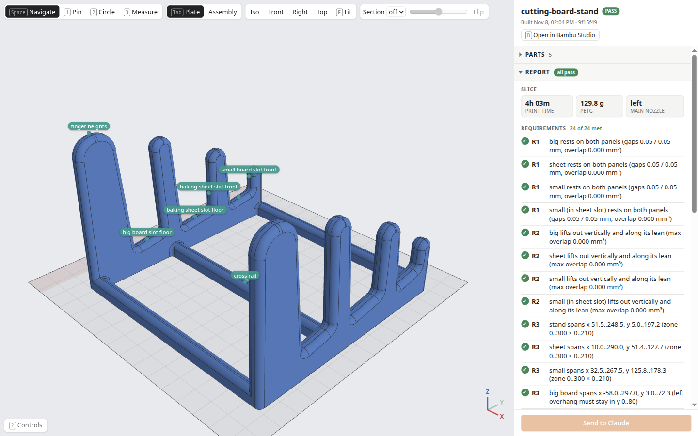
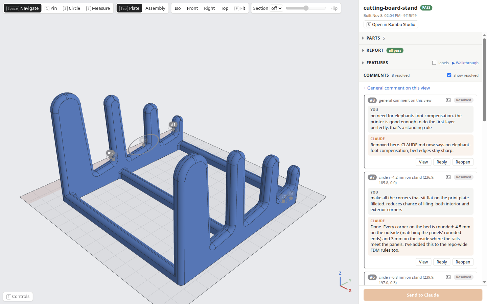
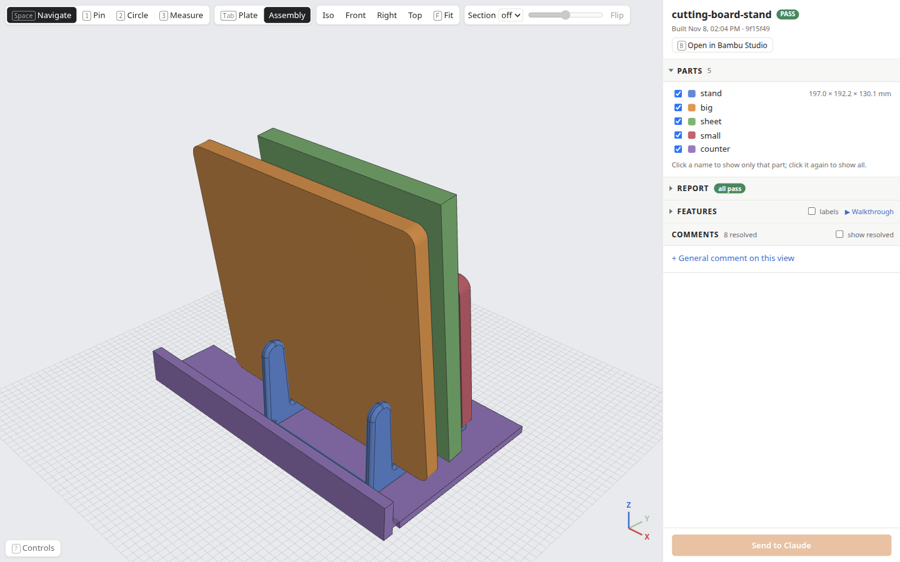
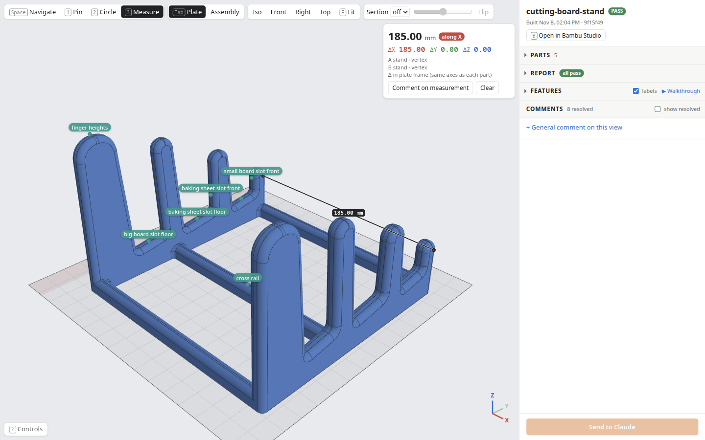
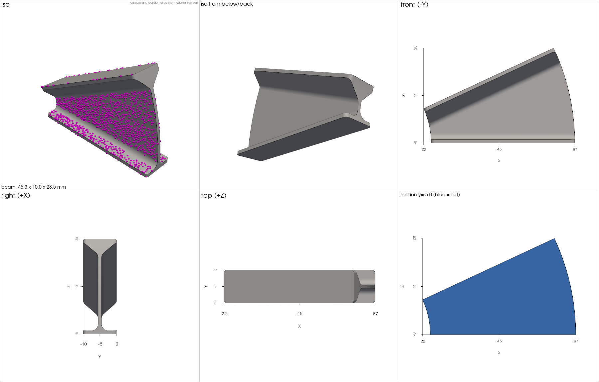

# claud3d

Design 3D-printed parts by talking to Claude.

Describe the part you need. [Claude Code](https://claude.com/claude-code) models it in [build123d](https://github.com/gumyr/build123d), checks that it will print, shows it to you in your browser, and slices it for your printer.

<!-- Demo video goes here. -->



## What you get

- Parametric models. Every dimension is a named parameter, and every requirement has a check that measures the built part.
- Printability checks before you print: overhangs, bridges, thin walls, build volume, and parts that collide.
- Review in the browser. Pin or circle what should change and send it; Claude edits the model and replies in the thread.
- A sliced Bambu Studio project, or plain STL files for any other slicer.

## Quick start

```bash
git clone https://github.com/theepicflyer/claud3d.git
cd claud3d
uv sync
claude
```

Then describe a part. The first time, Claude asks about your printer and filaments.

You need [uv](https://docs.astral.sh/uv/) and [Claude Code](https://claude.com/claude-code). [Bambu Studio](https://bambulab.com/en/download/studio) is optional. So far it's only been tested on Linux with the Bambu Studio flatpak.

## Screenshots

| | |
|---|---|
|  |  |
| Comment on the model, and Claude replies | See the parts assembled |
|  |  |
| Measure with snapping to real edges | Problem areas marked on every build |

## Learn more

- [CLAUDE.md](CLAUDE.md) is how Claude works on a part. It also lists the `cad` commands and the review app's features.
- [`projects/`](projects) has three example projects, each with its requirements, decisions and review history.
- Your printer setup (`printer.local.toml`, `CLAUDE.local.md`) and private projects (`private/`) are gitignored, so you can fork this repo publicly.

## License

[MIT](LICENSE). The vendored [three.js](https://threejs.org/) and [three-mesh-bvh](https://github.com/gkjohnson/three-mesh-bvh) are MIT licensed by their authors.
