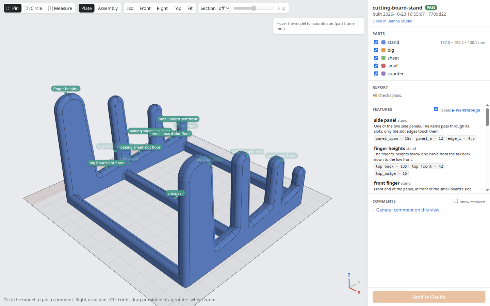
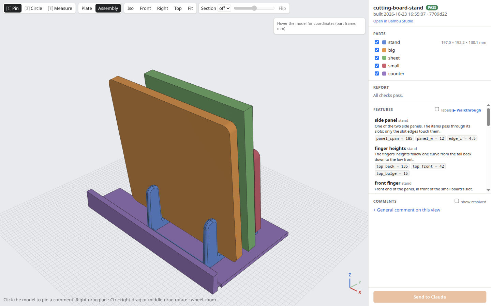
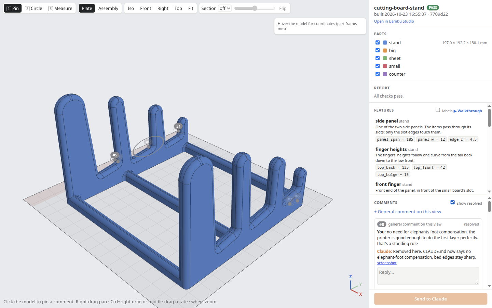
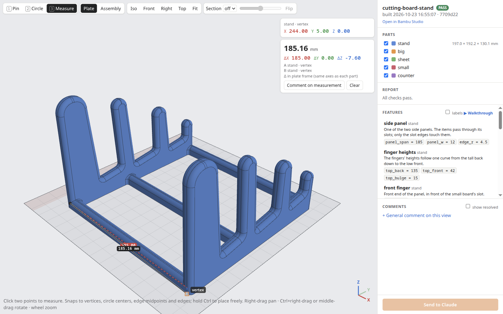
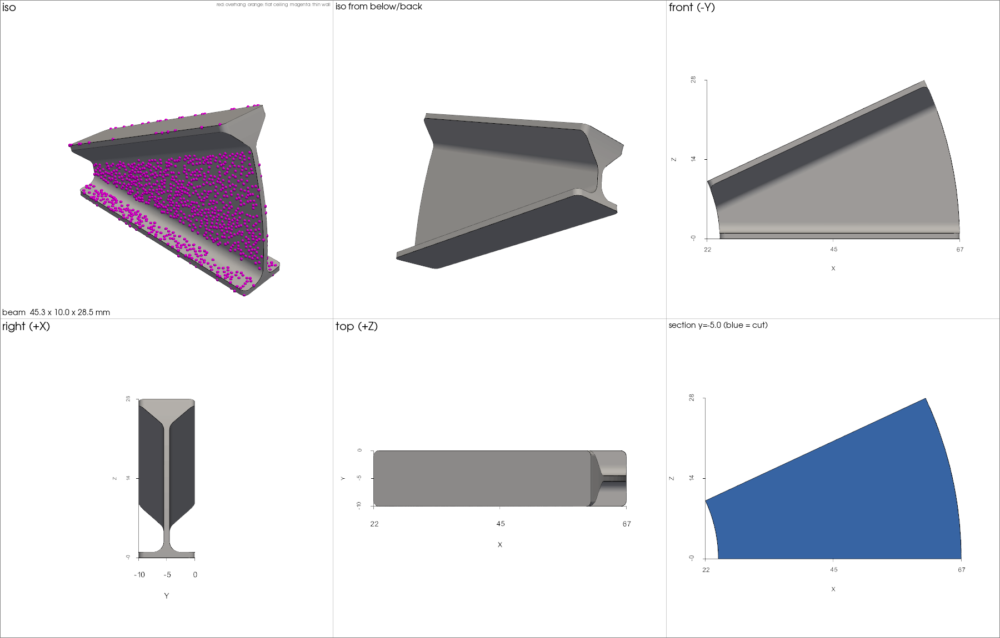

# claud3d

A workflow and toolkit for designing 3D-printed parts with [Claude Code](https://claude.com/claude-code). You describe the part. Claude writes a parametric [build123d](https://github.com/gumyr/build123d) model, checks it for printability, shows it to you in a browser viewer where you can leave comments, and slices it for your printer.

The method is written down in [CLAUDE.md](CLAUDE.md): how Claude pins down requirements, picks a print orientation, models, verifies its own work, takes review comments and hands off a print. Claude Code reads it when you run `claude` in this folder. The framework that Claude drives lives in `cadlib/` and the `cad` command: builds, printability checks, renders, slicing and the review app.



## How it works

1. You tell Claude what you need, for example "a stand that holds two cutting boards on edge next to my sink". Claude asks for measurements and constraints and writes them down as numbered requirements with acceptance criteria.
2. Claude writes `projects/<name>/model.py`. Every dimension is a parameter, and each requirement has a check that measures the built geometry.
3. `cad build` exports STEP and STL, then checks the parts: manifold, build volume, bed contact, overhangs, bridges, wall thickness, interference between assembled parts. It also runs the model's own requirement checks, renders PNG contact sheets with problem areas coloured in, slices, and writes a report. Claude reads the report and looks at the renders before showing you anything.
4. `cad review` opens a 3D viewer in your browser. You can measure (it snaps to real edges and circle centres), cut a section, switch between the print plate and the assembled view, and step through Claude's labels for the model's features. To give feedback, pin a point or circle an area and type a comment. Press "Send to Claude" and Claude gets your comments, each with a screenshot and coordinates, then changes the model and replies in the same threads.
5. When you're happy, `cad open` opens the sliced project in Bambu Studio. Without a slicer configured, you get the checked STL files.

`projects/` holds three real projects you can build and look at: `example-box` (a box with a friction-fit lid), `cutting-board-stand` and `curved-i-beam`. Each has its requirements, decisions and review history in its own `CLAUDE.md` and `review/` folder.

## Screenshots

The assembled view puts each part where it goes. Here the stand holds the two cutting boards and a baking sheet, sitting on the counter.



The comment threads stay with the model. Each marker is a comment you left, and Claude's reply says what it changed.



Measuring snaps to the exact CAD geometry and splits the distance into X, Y and Z. This one confirms the 185 mm panel span.



Each build writes a render sheet per part for Claude to look at. This curved I-beam has 1 mm walls on purpose, so the wall-thickness check marks them in magenta.



## Requirements

- [uv](https://docs.astral.sh/uv/) (it installs Python 3.13 and the dependencies)
- [Claude Code](https://claude.com/claude-code)
- A slicer, optional. [Bambu Studio](https://bambulab.com/en/download/studio) is built in: `cad build` slices with its CLI using your presets, and reads your printer's printable area from the machine preset. For any other slicer, `cad build` stops at checked STL files, and you or Claude slice them.
- FreeCAD, optional, for opening STEP files.

It has only been tested on Linux with the Bambu Studio flatpak. Other platforms and native Bambu Studio installs probably need small changes to `cadlib/bambu.py`.

## Getting started

```bash
git clone https://github.com/theepicflyer/claud3d.git
cd claud3d
uv sync
uv run pytest -q
uv run cad build example-box
```

Then run `claude` in the folder and describe a part. On first use Claude asks about your printer, slicer and filaments, and writes them to `printer.local.toml`.

## Your setup stays local

These are gitignored, so you can fork the repo, push it publicly and keep your own setup and models out of it:

- `printer.local.toml`: your printer, slicer presets, materials and fit clearances, merged over the defaults in `printer.toml`. To build without a slicer:

  ```toml
  [printer]
  name = "My printer"
  slicer = "none"
  build_volume = [220, 220, 250]
  ```

- `CLAUDE.local.md`: your preferences for Claude, such as printer quirks, the materials you have, and how much git you want it to handle. Claude Code loads it automatically.
- `private/`: projects you don't want to publish. `uv run cad new <name> --private` creates one there, and every other command finds it by name. You can make `private/` its own git repo with a private remote.

## Commands

```
uv run cad new <name> [--private]      create a project from the template
uv run cad build <name> [-p key=val]   export, check, render, slice; writes <project>/out/
uv run cad review <name>               open the review app in the browser
uv run cad comments <name> [--all]     list review threads
uv run cad reply <name> <id> "text"    reply to a thread (--resolve to close it)
uv run cad open <name> [--step]        open the sliced project in Bambu Studio, or STEP files in FreeCAD
uv run cad profiles machine|process|filament [regex]   list Bambu Studio presets
uv run cad list                        list projects and their last build status
```

A build writes these to `out/`:

- `<part>.step` and `<part>.stl` for each part
- `<part>.png`: iso, below, front, right and top views and a cross-section. Overhangs are red, flat ceilings orange and thin walls magenta.
- `assembly.png`, if the model defines an assembly
- `report.md` and `report.json`: every check, plus slice time and filament weight
- `slice/<project>.gcode.3mf`: the sliced Bambu Studio project, when a slicer is configured

## Review app controls

The right mouse button navigates: drag to pan, Ctrl+drag or middle-drag to rotate, wheel to zoom. The left button runs the current tool: 1 pin, 2 circle, 3 measure. B opens the sliced project in Bambu Studio.

## License

[MIT](LICENSE). The vendored [three.js](https://threejs.org/) and [three-mesh-bvh](https://github.com/gkjohnson/three-mesh-bvh) in `cadlib/review/static/vendor/` are MIT licensed by their authors.
