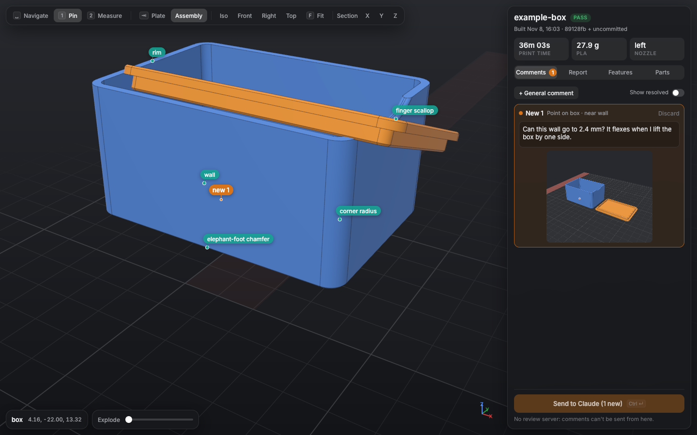

# Native review app (experimental)

A desktop version of the review app, written in Rust with [Rune](https://github.com/anomalyco/rune), a GPU UI framework. It reads the same build output as the browser app and sends comments through the same review server, so Claude sees no difference.



## Run it

```bash
uv run cad review <name> --native
```

This builds the app with cargo if needed (the first build takes a few minutes), starts the review server without opening a browser, and opens a window pointed at it. "Send to Claude" works as in the browser: the server saves the threads and screenshots, prints them, and exits, and the window closes itself. Closing the window without sending also ends the review.

You need a recent stable Rust (tested with 1.99). On Linux, Rune links `libxkbcommon` and `libwayland-client`. Only Linux with Wayland has been tried so far.

## What's different from the browser app

- Parts fly between Plate and Assembly instead of jumping, arcing over each other, and the assembled view has an Explode slider.
- The panels float over the 3D view and blur it.
- Assembly-only parts (boards, counters and other context) are drawn translucent, and clicks go through them to the printed parts.
- The wheel zooms toward the point under the pointer.
- Rune has no right-drag, so Shift-drag or middle-drag pans.
- Tools: 1 pins a comment, 2 measures (snapping to B-rep vertices, circle centres and edge midpoints; Shift-click places a point freely). There's no circle tool yet.
- The walkthrough shows a caption card. ← and → step through the features.
- Unsent drafts live only as long as the window.

Press `?` in the app for all the keys.

## Check it headlessly

Every Rune app renders offscreen with the same renderer, so changes can be checked without a window:

```bash
cd review-native
cargo build --release
B=target/release/cad-review
$B --project ../projects/example-box --snap shot.png --size 1440x900 --theme dark
$B --project ../projects/example-box --snap asm.png --scene assembly   # also: exploded, report, features, parts, section, help
$B --project ../projects/example-box --script pin.json --snap pin.png --at 3
cargo test --release
```

A script is `{"events": [{"t": 0.5, "type": "key", "name": "1"}, {"t": 0.8, "type": "tap", "x": 320, "y": 460}, ...]}`; Rune's [tooling docs](https://github.com/anomalyco/rune/blob/dev/crates/rune/README.md#agent-tooling-headless-no-window-same-renderer-fixed-virtual-clock) list the events. Add `--server http://127.0.0.1:PORT` to send to a running `uv run cad review <name> --no-open --keep`.

## How it's built

- `data.rs` reads `out/view.json`, the part STLs and `topo.json`, and `review/comments.json`.
- `mesh.rs` parses STL and builds a BVH for picking, snapping and hiding labels behind the model.
- `camera.rs` has the orbit camera, its springs, and each part's pose between plate and assembly.
- `gfx.rs` and `scene.wgsl` are a Rune compositor. They draw the parts, edges, bed and markers into an offscreen 4x MSAA target with a depth buffer, then paint that image at the viewport's effect slot inside Rune's own frame, so the frosted panels blur it like any other content. Screenshots for comments are read back from the same target.
- `app.rs` holds the state: tools, drafts, replies, and sending (`net.rs` posts to the server's `/api/send`).
- `ui.rs`, `side.rs` and `style.rs` are the view: the viewport, labels, toolbar and sidebar.

Rune is pinned to one `dev` revision in `Cargo.toml`.
